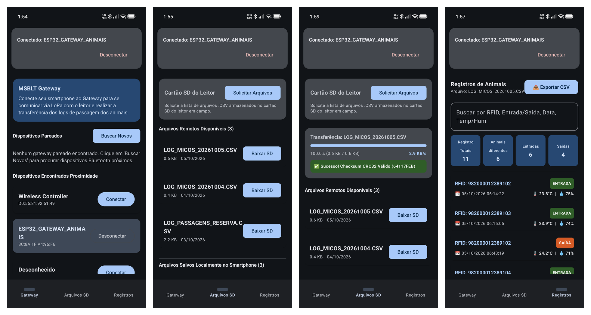
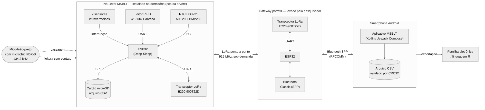
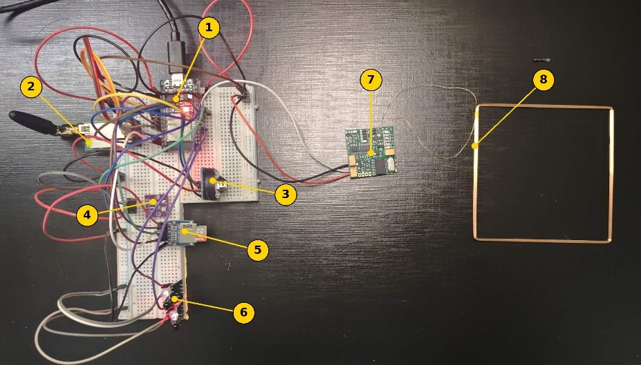
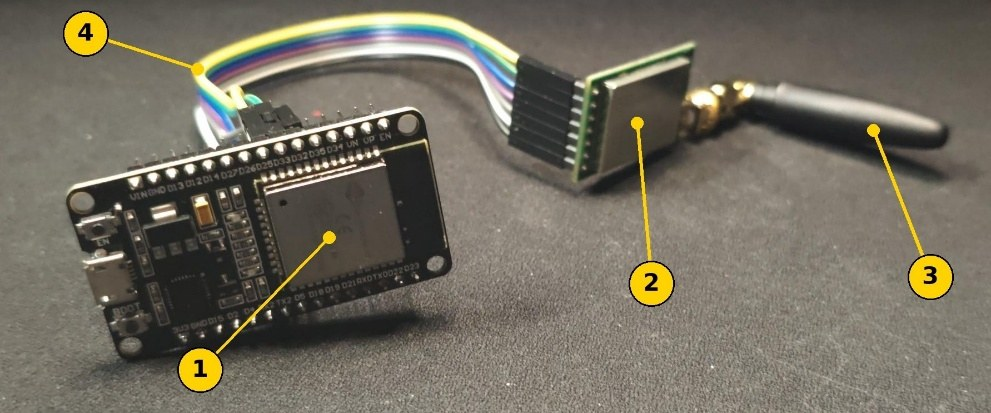
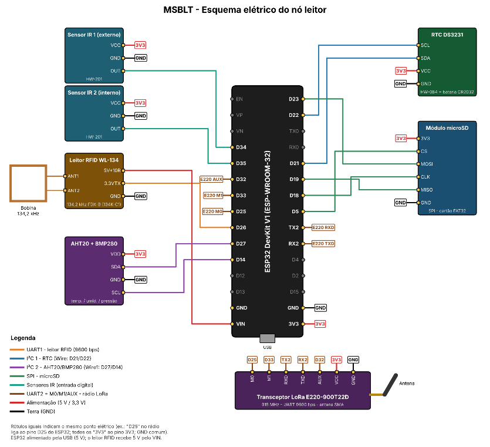
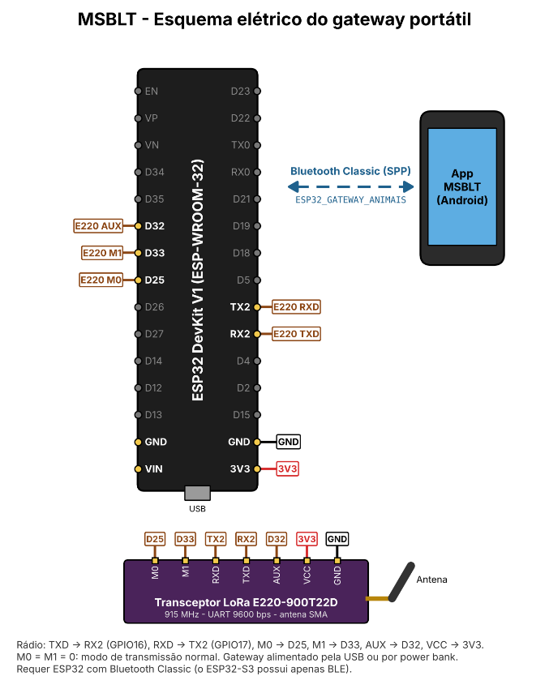

# MSBLT – Monitoring System for Black Lion Tamarins

**English** | [Português](README.pt-BR.md)

An IoT system for automated, non-invasive monitoring of how **black lion tamarins** (*Leontopithecus chrysopygus*), an endangered primate of Brazil's Atlantic Forest, use their natural sleeping sites (tree hollows).

A reader node installed at the entrance of the sleeping site identifies each microchipped animal by RFID, detects whether it is **entering or leaving**, and logs the event with a timestamp, temperature, humidity and pressure. During field visits, researchers download the logs to an Android app through a portable LoRa gateway, **without touching the installed device**.

> Undergraduate thesis (Trabalho de Graduação) – Systems Analysis and Development, Fatec Itapetininga, 2026.

<p align="center">
  
</p>

---

## Why

Black lion tamarins are endangered, mainly because the Atlantic Forest has been fragmented. Conventional monitoring depends on human observers in the field. That makes continuous observation impossible and individual identification difficult. MSBLT records every visit to a sleeping site automatically, 24/7, and ties it to a specific animal.

## How it works



The system has three layers, linked wirelessly:

| Layer | Device | Role |
|---|---|---|
| 1 | **Reader node** (ESP32) | Reads the animal's FDX-B microchip, detects direction with two IR sensors, timestamps and records environmental data, and stores daily CSV files on a microSD card |
| 2 | **Portable gateway** (ESP32) | Carried by the researcher. Bridges point-to-point **LoRa (915 MHz)** to **Bluetooth Classic (SPP)** |
| 3 | **Android app** (Kotlin) | Lists and downloads the reader's files, validates them with **CRC32**, and lets the user browse, filter and export the records |

No fixed telecom infrastructure is needed in the forest. The data stays safe on the reader's SD card until a researcher collects it.

## Features

- **RFID identification**: 134.2 kHz FDX-B microchips (ISO 11784/11785)
- **Direction detection**: the order in which two IR sensors trigger tells an **entry** from an **exit**
- **Environmental data**: temperature and humidity (AHT20) and pressure (BMP280) with every event
- **Accurate timestamps** from a DS3231 real-time clock
- **Local storage**: one CSV file per day on microSD, ready for spreadsheets or R
- **On-demand LoRa transfer**: files are sent in 128-byte blocks with per-frame acknowledgment, retransmission and duplicate filtering
- **Integrity check**: the app verifies every downloaded file with CRC32
- **Android app**: gateway pairing, remote file browser, record history with metrics (entries, exits, distinct animals), search and CSV export

## Hardware

<p align="center">
  
  
</p>
<p align="center"><em>Left: reader node prototype · Right: portable gateway prototype</em></p>

| Component | Reader node | Gateway |
|---|:---:|:---:|
| ESP32 DevKit (WROOM-32) | Yes | Yes |
| LoRa transceiver E220-900T22D (UART) | Yes | Yes |
| RFID reader WL-134 + coil antenna (134.2 kHz) | Yes | |
| 2× HW-201 reflective IR sensors | Yes | |
| RTC DS3231 | Yes | |
| AHT20 + BMP280 environmental sensor | Yes | |
| microSD card module | Yes | |

<details>
<summary><strong>Electrical schematics</strong> (click to expand)</summary>

**Reader node**


**Portable gateway**


</details>

Schematics and wiring tables are in [`hardware/`](hardware/).

## Tech stack

- **Firmware:** C++ / Arduino framework on ESP32, `BluetoothSerial`, `SD`, `Wire`/`SPI`, RTClib, Adafruit AHTX0, Adafruit BMP280
- **App:** Kotlin, Jetpack Compose, MVVM (ViewModel), Android Bluetooth Classic API, Gradle (Kotlin DSL)
- **Communication:** LoRa point-to-point (915 MHz), Bluetooth SPP (RFCOMM), custom text protocol with CRC32
- **Testing:** JUnit unit tests for CRC32 and CSV parsing (`ProtocolTest`)
- **Modeling:** UML (use case, class, state machine, activity and sequence diagrams)

## Repository structure

```
.
├── app/                    # Android app (Android Studio project)
├── firmware/
│   ├── reader/MSBLT_Reader/    # Reader node firmware
│   └── gateway/MSBLT_Gateway/  # Portable gateway firmware
├── hardware/               # Electrical schematics and wiring tables
└── docs/
    ├── images/             # Photos, architecture, app screenshots
    └── diagrams/           # UML diagrams
```

## Getting started

### Firmware (reader and gateway)

1. Install the [Arduino IDE](https://www.arduino.cc/en/software) and the **ESP32 board package** (Espressif).
2. Install the libraries from the Library Manager: **RTClib** (Adafruit), **Adafruit AHTX0** and **Adafruit BMP280 Library**.
3. Open `firmware/reader/MSBLT_Reader/MSBLT_Reader.ino` or `firmware/gateway/MSBLT_Gateway/MSBLT_Gateway.ino`.
4. Select the board **"ESP32 Dev Module"** and upload.
   > The gateway needs a standard ESP32 with Bluetooth Classic. The **ESP32-S3 will not work**.
5. Open the Serial Monitor at **115200 baud**. On the gateway, type `help` to test without a phone.

To set the reader's RTC, set `AJUSTAR_RTC` to `true` once and upload. Then set it back to `false` and upload again. Each module can be turned on or off with the `USAR_*` flags at the top of the reader firmware.

### Android app

1. Open the `app/` folder in **Android Studio**.
2. Let Gradle sync, then run on a device with **Android 11 (API 30) or newer**.
3. Turn on Bluetooth, pair with `ESP32_GATEWAY_ANIMAIS`, and connect from the **Gateway** tab.

## Communication protocol

```
App ──Bluetooth──▶ Gateway ──LoRa──▶ Reader
LIST_FILES              →  CMD_LIST
START_DOWNLOAD:<file>   →  CMD_READ:<file>
CANCEL_DOWNLOAD         →  CMD_CANCEL

Reader ──LoRa──▶ Gateway ──Bluetooth──▶ App   (forwarded unchanged)
FILE_ITEM:<name>:<size>:<DD/MM/YYYY>:<CRC32> ... LIST_END
FILE_HEADER, CHUNK:<i>:<base64 128 bytes> ..., FILE_END, ERROR
```

The gateway acknowledges each frame with `CMD_OK:<H|index|E>`. The reader retransmits if no acknowledgment arrives (up to 5 times, 3 s timeout), and the gateway discards repeated frames.

**Record format** (one line per passage, daily file `LOG_MICOS_YYYYMMDD.CSV`):

```
RFID;EVENT_TYPE;DATE_TIME;TEMPERATURE;HUMIDITY;PRESSURE
```

`EVENT_TYPE` is `ENTRADA` (entry), `SAÍDA` (exit) or `INDEFINIDO` (undetermined).

## Test results

| Test | Result |
|---|---|
| RFID reading | FDX-B microchip read correctly at up to **~9 cm** from the antenna |
| Passage direction | Entries (IR1 → IR2) and exits (IR2 → IR1) identified correctly |
| Date and time | Every record timestamped by the DS3231 |
| Environmental data | e.g. 25.6 °C, 73.4 % RH, 941.7 hPa |
| Storage | Daily CSV files written and opened correctly in a spreadsheet |
| Data transfer | File downloaded through the gateway with a valid CRC32 |
| Range | Full transfer with valid CRC32 at **170 m**, in an urban area, with the reader indoors behind concrete walls and a metal window |

## Limitations and future work

The prototype validates the system's functional logic, but it is **not field-ready yet**:

- [ ] Power management (ESP32 deep sleep, MOSFET switching of the RFID reader, LoRa WOR mode). These are modeled but not implemented, and the prototype runs on USB power.
- [ ] Measure power consumption and battery or solar autonomy
- [ ] Camouflaged, weatherproof enclosure for the reader node
- [ ] Monitoring-point ID in each record, to support several reader nodes
- [ ] LoRa range tests in dense forest
- [ ] Field validation with the researchers who monitor the species

## Documentation

UML diagrams are in [`docs/diagrams/`](docs/diagrams/): [use case](docs/diagrams/use-case.png), [class](docs/diagrams/class-diagram.png), [reader state machine](docs/diagrams/reader-state-machine.png), and the activity and sequence diagrams for each use case. The diagrams are in Portuguese.

## Authors

- Cauan Gabriel do Carmo Nogueira
- Cayos da Silva Souza
- Luan Miguel Fidencio Rodrigues

**Advisor:** Prof. Esp. Rodrigo Diniz, Fatec Itapetininga

## Acknowledgments

Thanks to Prof. Dr. Laurence Culot and biologist Felipe Bufalo (UNESP Rio Claro) for their trust in the project and for the information that shaped the system's requirements.

## License

This project is licensed under the [MIT License](LICENSE).
