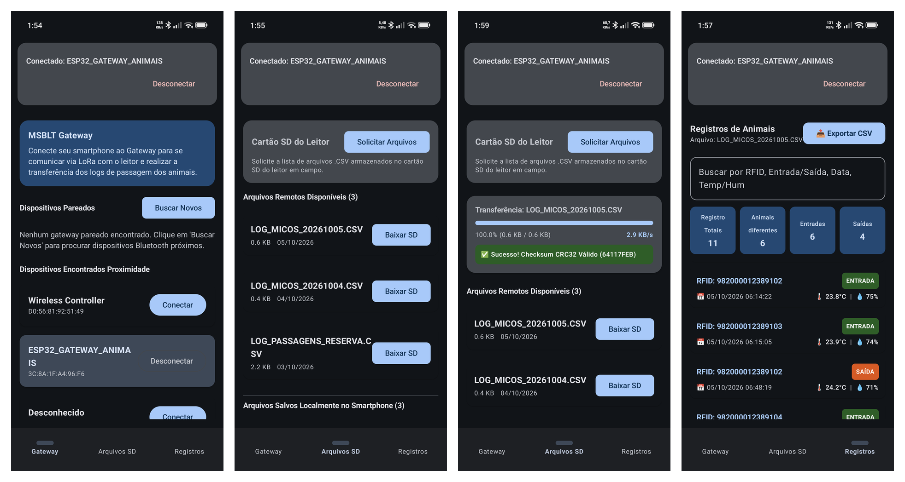
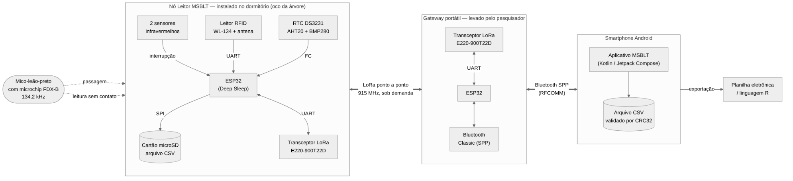
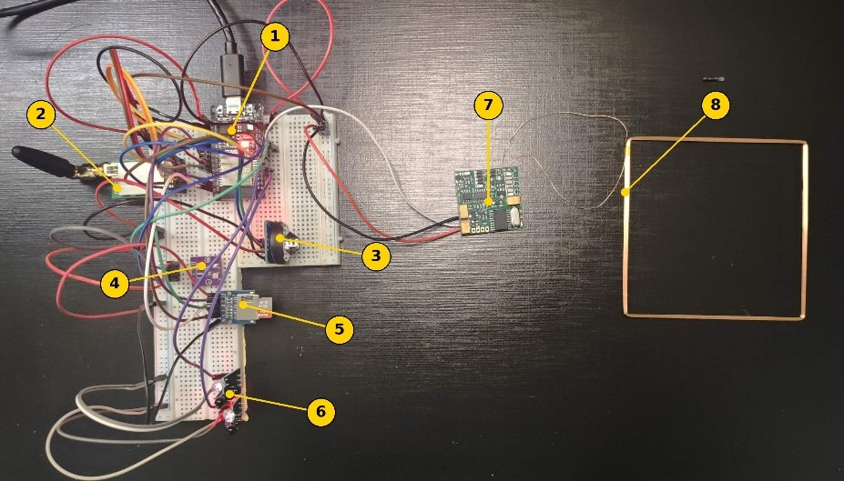
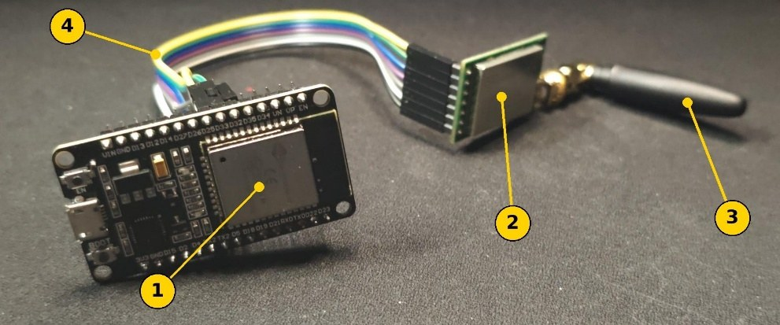
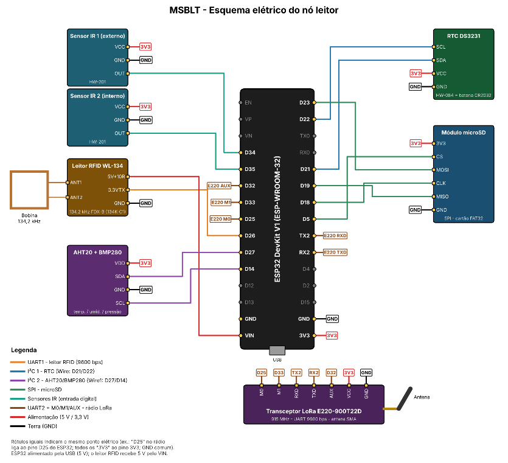
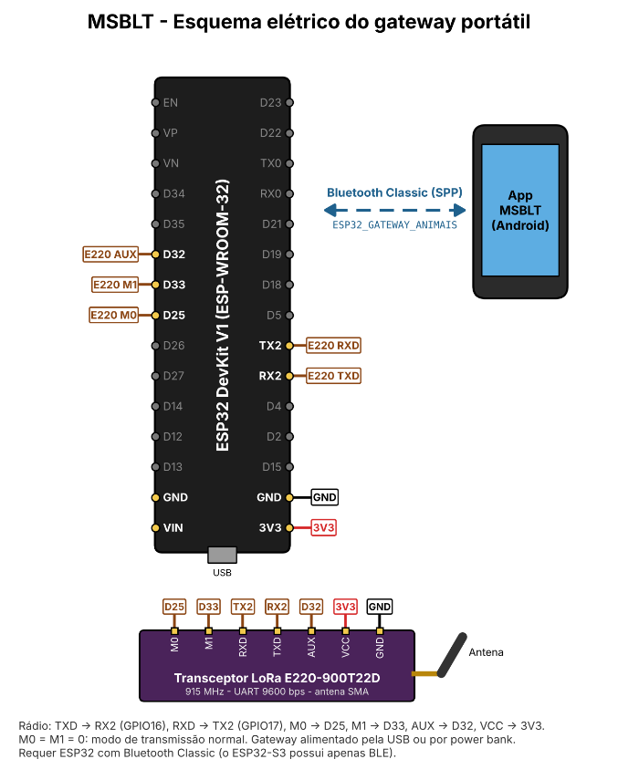

# MSBLT – Monitoring System for Black Lion Tamarins

[English](README.md) | **Português**

Sistema IoT para o monitoramento automatizado e não invasivo do uso de dormitórios naturais (ocos de árvores) pelo **mico-leão-preto** (*Leontopithecus chrysopygus*), primata ameaçado de extinção da Mata Atlântica.

Um nó leitor instalado na entrada do dormitório identifica cada animal microchipado por RFID, detecta se ele está **entrando ou saindo** e registra o evento com data, hora, temperatura, umidade e pressão. Nas visitas a campo, o pesquisador descarrega os registros num aplicativo Android por meio de um gateway LoRa portátil, **sem precisar manusear o dispositivo instalado**.

> Trabalho de Graduação – Análise e Desenvolvimento de Sistemas, Fatec Itapetininga, 2026.

<p align="center">
  
</p>

---

## Motivação

A fragmentação da Mata Atlântica colocou o mico-leão-preto em risco de extinção. Os métodos convencionais de monitoramento dependem de observadores humanos em campo, o que impede o acompanhamento contínuo e dificulta a identificação individual dos animais. O MSBLT registra automaticamente, 24 horas por dia, cada visita ao dormitório e a associa a um animal específico.

## Como funciona



O sistema tem três camadas, ligadas sem fio:

| Camada | Dispositivo | Função |
|---|---|---|
| 1 | **Nó leitor** (ESP32) | Lê o microchip FDX-B do animal, detecta o sentido com dois sensores IR, registra data, hora e dados ambientais e grava arquivos CSV diários no microSD |
| 2 | **Gateway portátil** (ESP32) | Levado pelo pesquisador. Faz a ponte entre o enlace **LoRa (915 MHz)** e o **Bluetooth Classic (SPP)** |
| 3 | **Aplicativo Android** (Kotlin) | Lista e baixa os arquivos do leitor, valida-os por **CRC32** e permite consultar, filtrar e exportar os registros |

Não é necessária nenhuma infraestrutura fixa de telecomunicações na mata. Os dados ficam preservados no cartão SD do leitor até a coleta pelo pesquisador.

## Funcionalidades

- **Identificação por RFID**: microchips FDX-B de 134,2 kHz (ISO 11784/11785)
- **Sentido da passagem**: a ordem de acionamento de dois sensores IR distingue **entrada** de **saída**
- **Dados ambientais**: temperatura e umidade (AHT20) e pressão (BMP280) em cada evento
- **Data e hora precisas** com o relógio de tempo real DS3231
- **Armazenamento local**: um arquivo CSV por dia no microSD, pronto para planilhas ou para a linguagem R
- **Transferência LoRa sob demanda**: arquivos enviados em blocos de 128 bytes, com confirmação por quadro, retransmissão e descarte de duplicados
- **Verificação de integridade**: o app valida cada arquivo baixado por CRC32
- **Aplicativo Android**: pareamento com o gateway, navegação nos arquivos remotos, histórico de registros com métricas (entradas, saídas, animais distintos), busca e exportação em CSV

## Hardware

<p align="center">
  
  
</p>
<p align="center"><em>Esquerda: protótipo do nó leitor · Direita: protótipo do gateway portátil</em></p>

| Componente | Nó leitor | Gateway |
|---|:---:|:---:|
| ESP32 DevKit (WROOM-32) | Sim | Sim |
| Transceptor LoRa E220-900T22D (UART) | Sim | Sim |
| Leitor RFID WL-134 + antena bobina (134,2 kHz) | Sim | |
| 2× sensores reflexivos IR HW-201 | Sim | |
| RTC DS3231 | Sim | |
| Sensor ambiental AHT20 + BMP280 | Sim | |
| Módulo de cartão microSD | Sim | |

<details>
<summary><strong>Esquemas elétricos</strong> (clique para expandir)</summary>

**Nó leitor**


**Gateway portátil**


</details>

Os esquemas elétricos e as tabelas de ligação estão em [`hardware/`](hardware/).

## Tecnologias

- **Firmware:** C++ / framework Arduino no ESP32, `BluetoothSerial`, `SD`, `Wire`/`SPI`, RTClib, Adafruit AHTX0, Adafruit BMP280
- **Aplicativo:** Kotlin, Jetpack Compose, MVVM (ViewModel), API Bluetooth Classic do Android, Gradle (Kotlin DSL)
- **Comunicação:** LoRa ponto a ponto (915 MHz), Bluetooth SPP (RFCOMM), protocolo textual próprio com CRC32
- **Testes:** testes unitários JUnit para CRC32 e leitura de CSV (`ProtocolTest`)
- **Modelagem:** UML (diagramas de caso de uso, classes, máquina de estados, atividade e sequência)

## Estrutura do repositório

```
.
├── app/                    # Aplicativo Android (projeto do Android Studio)
├── firmware/
│   ├── reader/MSBLT_Reader/    # Firmware do nó leitor
│   └── gateway/MSBLT_Gateway/  # Firmware do gateway portátil
├── hardware/               # Esquemas elétricos e tabelas de ligação
└── docs/
    ├── images/             # Fotos, arquitetura, telas do app
    └── diagrams/           # Diagramas UML
```

## Como executar

### Firmware (leitor e gateway)

1. Instale o [Arduino IDE](https://www.arduino.cc/en/software) e o **pacote de placas ESP32** (Espressif).
2. Instale pelo Gerenciador de Bibliotecas: **RTClib** (Adafruit), **Adafruit AHTX0** e **Adafruit BMP280 Library**.
3. Abra `firmware/reader/MSBLT_Reader/MSBLT_Reader.ino` ou `firmware/gateway/MSBLT_Gateway/MSBLT_Gateway.ino`.
4. Selecione a placa **"ESP32 Dev Module"** e grave.
   > O gateway precisa de um ESP32 comum, com Bluetooth Classic. O **ESP32-S3 não funciona**.
5. Abra o Monitor Serial em **115200 baud**. No gateway, digite `help` para testar sem o celular.

Para acertar o RTC do leitor, mude `AJUSTAR_RTC` para `true` e grave uma vez. Depois volte para `false` e grave de novo. Cada módulo pode ser ligado ou desligado pelas chaves `USAR_*` no início do firmware do leitor.

### Aplicativo Android

1. Abra a pasta `app/` no **Android Studio**.
2. Aguarde a sincronização do Gradle e execute num aparelho com **Android 11 (API 30) ou superior**.
3. Ative o Bluetooth, pareie com `ESP32_GATEWAY_ANIMAIS` e conecte pela aba **Gateway**.

## Protocolo de comunicação

```
App ──Bluetooth──▶ Gateway ──LoRa──▶ Leitor
LIST_FILES              →  CMD_LIST
START_DOWNLOAD:<arq>    →  CMD_READ:<arq>
CANCEL_DOWNLOAD         →  CMD_CANCEL

Leitor ──LoRa──▶ Gateway ──Bluetooth──▶ App   (repassado sem alteração)
FILE_ITEM:<nome>:<tam>:<DD/MM/AAAA>:<CRC32> ... LIST_END
FILE_HEADER, CHUNK:<i>:<base64 128 bytes> ..., FILE_END, ERROR
```

O gateway confirma cada quadro com `CMD_OK:<H|índice|E>`. O leitor reenvia se a confirmação não chegar (até 5 tentativas, tempo limite de 3 s), e o gateway descarta quadros repetidos.

**Formato do registro** (uma linha por passagem, arquivo diário `LOG_MICOS_AAAAMMDD.CSV`):

```
RFID;TIPO_EVENTO;DATA_HORA;TEMPERATURA;UMIDADE;PRESSAO
```

`TIPO_EVENTO` pode ser `ENTRADA`, `SAÍDA` ou `INDEFINIDO`.

## Resultados dos testes

| Teste | Resultado |
|---|---|
| Leitura RFID | Microchip FDX-B lido corretamente a até **~9 cm** da antena |
| Sentido de passagem | Entradas (IR1 → IR2) e saídas (IR2 → IR1) identificadas corretamente |
| Data e hora | Todos os registros com data e hora do DS3231 |
| Variáveis ambientais | Ex.: 25,6 °C, 73,4 % UR, 941,7 hPa |
| Armazenamento | Arquivos CSV diários gravados e abertos corretamente em planilha |
| Transferência de dados | Arquivo baixado via gateway com CRC32 válido |
| Alcance | Transferência completa com CRC32 válido a **170 m**, em ambiente urbano, com o leitor dentro de um cômodo com paredes de concreto e janela metálica |

## Limitações e trabalhos futuros

O protótipo valida a lógica funcional do sistema, mas **ainda não está pronto para campo**:

- [ ] Gerenciamento de energia (Deep Sleep do ESP32, desligamento do leitor RFID por MOSFET, modo WOR do LoRa). Está modelado, mas não implementado, e o protótipo opera alimentado por USB.
- [ ] Medir o consumo e a autonomia com bateria ou painel solar
- [ ] Invólucro camuflado e resistente às intempéries para o nó leitor
- [ ] Identificação do ponto de monitoramento em cada registro, para operar vários nós leitores
- [ ] Testes de alcance do LoRa em mata densa
- [ ] Validação em campo com os pesquisadores responsáveis pelo monitoramento da espécie

## Documentação

Os diagramas UML estão em [`docs/diagrams/`](docs/diagrams/): [caso de uso](docs/diagrams/use-case.png), [classes](docs/diagrams/class-diagram.png), [máquina de estados do leitor](docs/diagrams/reader-state-machine.png), além dos diagramas de atividade e de sequência de cada caso de uso.

## Autores

- Cauan Gabriel do Carmo Nogueira
- Cayos da Silva Souza
- Luan Miguel Fidencio Rodrigues

**Orientador:** Prof. Esp. Rodrigo Diniz, Fatec Itapetininga

## Agradecimentos

À Profa. Dra. Laurence Culot e ao biólogo Felipe Bufalo (UNESP Rio Claro), pela confiança na proposta e pelas informações que orientaram os requisitos do sistema.

## Licença

Este projeto está sob a [Licença MIT](LICENSE).
