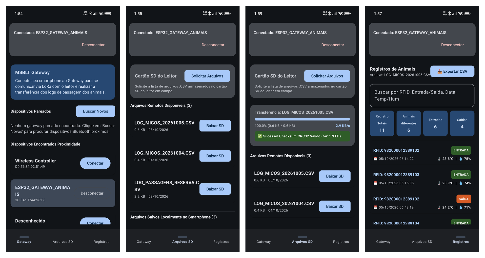

# MSBLT – Android App

**English** | [Português](#português)

Android app for the [MSBLT – Monitoring System for Black Lion Tamarins](../README.md). It connects to the portable ESP32 gateway over **Bluetooth Classic**. Through the gateway, it lists and downloads the log files stored on the reader node's microSD card, checks their integrity with **CRC32**, and lets the researcher browse, filter and export the records.

<p align="center">
  
</p>

## Features

- **Gateway tab:** discover, pair and connect to `ESP32_GATEWAY_ANIMAIS`
- **SD Files tab:** request the list of CSV files on the reader node, download them with a progress bar and a CRC32 check, and manage the files saved on the phone
- **Records tab:** passage history with metrics (total records, distinct animals, entries, exits), search by RFID, event, date or temperature/humidity, and export to an Excel-compatible CSV (UTF-8 with BOM, `;` separator)

## Tech stack

- **Kotlin** + **Jetpack Compose** (Material 3)
- **MVVM** with `ViewModel` and `StateFlow`
- Android **Bluetooth Classic** (RFCOMM / SPP)
- `java.util.zip.CRC32` for integrity checks
- **JUnit** unit tests
- Gradle Kotlin DSL with a version catalog (`gradle/libs.versions.toml`)

## Project structure

```
app/src/main/java/com/oblytoid/msblt/
├── MainActivity.kt
├── data/
│   ├── bluetooth/   # BluetoothController: discovery, connection, I/O
│   └── protocol/    # Crc32Utils: CRC32, CSV parsing, export
└── ui/
    ├── BluetoothViewModel.kt
    ├── MainScreen.kt
    ├── components/  # StatusHeader, FileDownloadCard
    ├── screens/     # Gateway, SD files, animal logs, protocol docs
    └── theme/
```

## Build and run

Requirements: **Android Studio** (recent version) and a device running **Android 11 (API 30)** or newer with Bluetooth.

1. Clone the repository and open **this `app/` folder** in Android Studio:
   ```bash
   git clone https://github.com/Oblytoid/Monitoring-System-for-Black-Lion-Tamarins.git
   ```
2. Wait for the Gradle sync, then run the `app` configuration on a physical device. The emulator has no Bluetooth.
3. Grant the Bluetooth permissions, turn on the gateway, and connect from the **Gateway** tab.

## Tests

`ProtocolTest` covers CRC32 calculation and verification, and parsing of the CSV records written by the reader firmware.

```bash
./gradlew test
```

## Protocol

See the [main README](../README.md#communication-protocol) for the App ↔ Gateway ↔ Reader commands and the record format.

---

## Português

Aplicativo Android do [MSBLT – Monitoring System for Black Lion Tamarins](../README.pt-BR.md). Ele se conecta ao gateway portátil ESP32 via **Bluetooth Classic**. Por meio do gateway, lista e baixa os arquivos de registro gravados no microSD do nó leitor, valida a integridade por **CRC32** e permite ao pesquisador consultar, filtrar e exportar os registros.

### Funcionalidades

- **Aba Gateway:** busca, pareamento e conexão com o `ESP32_GATEWAY_ANIMAIS`
- **Aba Arquivos SD:** solicita a lista de arquivos CSV do nó leitor, faz o download com barra de progresso e verificação CRC32, e gerencia os arquivos salvos no celular
- **Aba Registros:** histórico de passagens com métricas (total de registros, animais distintos, entradas, saídas), busca por RFID, evento, data ou temperatura/umidade, e exportação para CSV compatível com o Excel (UTF-8 com BOM, separador `;`)

### Tecnologias

Kotlin, Jetpack Compose (Material 3), MVVM (`ViewModel` + `StateFlow`), Bluetooth Classic (RFCOMM/SPP), CRC32 (`java.util.zip`), testes com JUnit e Gradle Kotlin DSL.

### Como executar

Requisitos: **Android Studio** (versão recente) e um aparelho com **Android 11 (API 30)** ou superior, com Bluetooth.

1. Clone o repositório e abra **esta pasta `app/`** no Android Studio.
2. Aguarde a sincronização do Gradle e execute num aparelho físico. O emulador não tem Bluetooth.
3. Conceda as permissões de Bluetooth, ligue o gateway e conecte pela aba **Gateway**.

### Testes

O `ProtocolTest` cobre o cálculo e a verificação do CRC32 e a leitura dos registros CSV gravados pelo firmware do leitor. Para rodar: `./gradlew test`.
